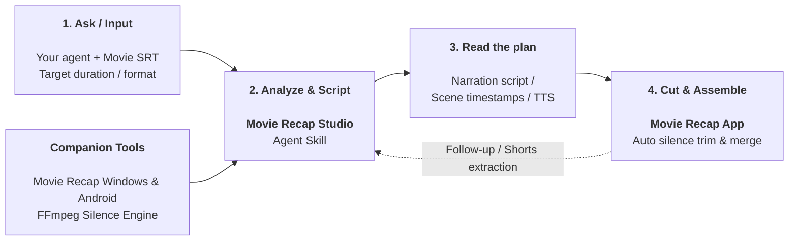

<div align="center">

# Movie Recap Studio

### Open-source Agent Skill + companion Movie Recap app releases for movie recap workflows.

[](https://github.com/trykamran/movie-recap-studio)
[](https://developers.openai.com/codex/)
[](https://docs.anthropic.com/)
[](LICENSE)

**One movie. One coherent story. A production-ready narration and scene plan.**

[Quick Start](#-quick-start-example) · [Features](#-what-it-does) · [How it works](#how-movie-recap-studio-works) · [Install](#-installation) · [Contributing](CONTRIBUTING.md)

</div>

---

## What is Movie Recap Studio?

**Movie Recap Studio** is an open-format **Agent Skill** that enables AI models (Claude, ChatGPT, Gemini) to analyze a movie subtitle file (`.srt`), write retention-focused recap narration, and output exact scene timestamps for automated video editing.

---

## 📱 Movie Recap Companion Apps

Automate your scene trimming, voiceover merging, and dead-pause removal with the official companion editing apps:

| Platform | Package | Description | Download |
|---|---|---|---|
| 💻 **Windows** | `MovieRecap-Setup.exe` | Complete Desktop Installer with embedded FFmpeg & Auto Silence Remover | [**Download Setup (57.4 MB)**](https://github.com/trykamran/movie-recap-studio/releases/latest/download/MovieRecap-Setup.exe) |
| 📱 **Android** | `MovieRecap.apk` | Mobile Android App optimized for modern 64-bit devices | [**Download APK (59.8 MB)**](https://github.com/trykamran/movie-recap-studio/releases/latest/download/MovieRecap.apk) |

> **Key Features:** Frame-accurate scene trimming, voiceover audio sync, background movie audio muting, and built-in **Auto Remove Silence** engine (cuts pauses >0.3s for rapid YouTube recap narration).

---

## ✨ What it does

- **Deep SRT Story Analysis:** Extracts plot beats, chronological scenes, and character arcs from raw subtitles.
- **Viral Recap Narration:** Crafts copyright-safe, engaging narration paced for maximum retention.
- **Automated Scene Alignment:** Generates frame-accurate timestamps mapped to the voiceover.
- **One-Click Video Assembly:** Outputs timestamp lists ready for instant import into the Movie Recap app.

---

## How Movie Recap Studio works

Your agent calls Movie Recap Studio to analyze movie subtitles (SRT), structure chronological storyline beats, and write narration scripts. Movie Recap Studio returns exact scene timestamps and audio sync points. The agent uses them to produce voiceovers and scene timelines, while the companion apps automate silence removal and final video assembly.

### Movie Recap Studio workflow



---

## 📦 Installation

### Claude / Cloud Agent (Single Prompt Install)

Copy and paste this single prompt directly into Claude or your cloud agent:

```text
https://github.com/trykamran/movie-recap-studio
Load this skill.
```

*(Terminal / Local clone)*:
```bash
git clone https://github.com/trykamran/movie-recap-studio.git ~/.claude/skills/movie-recap-studio
```

---

### ChatGPT / Custom GPTs

1. Open **Explore GPTs** → **Create a GPT**.
2. In **Instructions**, paste the text from [skills/movie-recap-studio/SKILL.md](skills/movie-recap-studio/SKILL.md).
3. Attach your movie `.srt` file to start creating recaps.

---

## 🚀 Quick Start Example

Paste this into your AI assistant after loading the skill:

```text
Use Movie Recap Studio.

I want to create a movie explanation video.
Here is my movie subtitle file: [paste or attach SRT].
Guide me through the workflow step by step.
```

---

## 📄 License

Distributed under the [MIT License](LICENSE).
