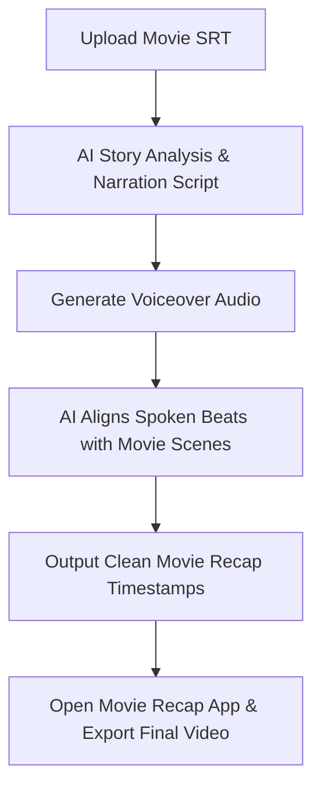

<div align="center">

# Movie Recap Studio

### Open-source Agent Skill + companion Movie Recap app releases for movie recap workflows.

[](https://github.com/trykamran/movie-recap-studio)
[](https://developers.openai.com/codex/)
[](https://docs.anthropic.com/)
[](LICENSE)

**One movie. One coherent story. A production-ready narration and scene plan.**

[Quick Start](#-quick-start) · [Features](#-what-it-does) · [Workflow](#-how-the-workflow-works) · [Install](#-installation) · [Contributing](CONTRIBUTING.md)

</div>

---

## What is Movie Recap Studio?

**Movie Recap Studio** is an open-format **Agent Skill** that enables AI models (Claude, ChatGPT, Gemini) to analyze a movie subtitle file (SRT), write original retention-focused recap narration, and generate exact scene timestamps for automated video editing.

---

## 📱 Movie Recap Companion Apps

Automate your cutting, voiceover merging, and dead-pause removal with the official companion editing apps:

| Platform | Package | Description | Download |
|---|---|---|---|
| 💻 **Windows** | `MovieRecap-Setup.exe` | Complete Desktop Installer with embedded FFmpeg & Auto Silence Remover | [**Download Setup (57.4 MB)**](https://github.com/trykamran/movie-recap-studio/releases/latest/download/MovieRecap-Setup.exe) |
| 📱 **Android** | `MovieRecap.apk` | Mobile Android App optimized for modern 64-bit devices | [**Download APK (59.8 MB)**](https://github.com/trykamran/movie-recap-studio/releases/latest/download/MovieRecap.apk) |

> **Key Features:** Frame-accurate scene trimming, voiceover audio sync, background movie audio muting, and built-in **Auto Remove Silence** engine (cuts pauses >0.3s for rapid YouTube recap narration).

---

## ✨ What it does

| Capability | Description |
|---|---|
| **Full & Short Recaps** | Plans long-form (~20 min) or short-form (~90 sec) explanations. |
| **Complete SRT Analysis** | Reads full movie subtitle files to extract character arcs, plot twists, and chronological scenes. |
| **Original Narration** | Generates engaging, copyright-safe English recap scripts with natural hooks. |
| **TTS Alignment** | Maps spoken voiceover beats against original movie scene timestamps. |
| **Movie Recap Output** | Produces clean timestamps formatted directly for one-click pasting into the Movie Recap app. |

---

## 🎬 How the workflow works



### 3 Simple Production Steps:
1. **AI Script & Timestamps:** Provide your movie subtitle (`.srt`) to Claude or ChatGPT with this skill. It analyzes the story, writes an original script, and gives exact scene timecodes.
2. **Generate Voiceover:** Record or generate your narration audio using any TTS service (ElevenLabs, etc.).
3. **One-Click Cut & Sync:** Open the **Movie Recap** app (Desktop or Mobile), drag & drop your video and voiceover, paste the timestamps, toggle **Auto Remove Silence**, and click **Start Cutting & Merge**!

---

## 📦 Installation

### 1. Claude / Cloud Agent (Single Prompt Install)

Copy and paste this single prompt directly into Claude:

```text
https://github.com/trykamran/movie-recap-studio
Load this skill.
```

*(Optional Terminal Install for Claude Code)*:
```bash
git clone https://github.com/trykamran/movie-recap-studio.git ~/.claude/skills/movie-recap-studio
```

---

### 2. ChatGPT / Custom GPTs
1. Open **Explore GPTs** → **Create a GPT**.
2. In **Instructions**, paste the text from [skills/movie-recap-studio/SKILL.md](skills/movie-recap-studio/SKILL.md).
3. Provide your movie `.srt` file to start creating recaps.

---

### 3. Gemini CLI / Antigravity / Cursor
Clone the skill directory:
```bash
git clone https://github.com/trykamran/movie-recap-studio.git ~/.gemini/skills/movie-recap-studio
```

---

## 🚀 Quick Start Example

Paste this into your AI assistant after loading the skill:

```text
Use Movie Recap Studio.

I want to create a full movie explanation video.
Here is my movie subtitle file: [paste or attach SRT].
Guide me through the workflow one step at a time.
```

---

## 📄 License

Distributed under the [MIT License](LICENSE).
