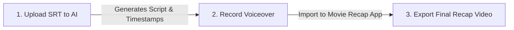

# 🎬 Movie Recap Studio

[](https://github.com/trykamran/movie-recap-studio)
[](https://docs.anthropic.com/)
[](https://openai.com/)
[](https://github.com/trykamran/movie-recap-studio)
[](https://github.com/trykamran/movie-recap-studio/releases/latest)
[](LICENSE)

An open-standard **AI Agent Skill** + **Automated Video Editing App** ecosystem for creating viral movie explanation videos, recaps, and Shorts.

---

## 📥 Download Companion Editing Apps

Download the official **Movie Recap** apps to automatically cut video clips, sync voiceovers, and remove audio silence with one click:

| Platform | File | Size | Link |
| :--- | :--- | :--- | :--- |
| 💻 **Windows** | `MovieRecap-Setup.exe` | 57.4 MB | [**Download Windows Installer**](https://github.com/trykamran/movie-recap-studio/releases/latest/download/MovieRecap-Setup.exe) |
| 📱 **Android** | `MovieRecap.apk` | 59.8 MB | [**Download Android APK**](https://github.com/trykamran/movie-recap-studio/releases/latest/download/MovieRecap.apk) |

> **Features:** Millisecond-accurate scene cutting, drag & drop voiceover sync, original audio muting, and built-in **Auto Remove Silence** engine (cuts pauses >0.3s for fast-paced recap narration).

---

## 🚀 How to Install the Agent Skill

You can install and use this skill in your favorite AI assistant in seconds.

### 1. Claude Code
Run this command in your terminal to install the skill:
```bash
git clone https://github.com/trykamran/movie-recap-studio.git ~/.claude/skills/movie-recap-studio
```
**Usage Prompt:**
```text
Load the movie-recap-studio skill and analyze my movie subtitle file to generate a 15-minute recap script with timestamps.
```

---

### 2. ChatGPT / Custom GPTs
1. Go to **Explore GPTs** → **Create a GPT**.
2. Under **Instructions**, paste the content of [SKILL.md](skills/movie-recap-studio/SKILL.md).
3. (Optional) In **Knowledge**, upload `dist/movie-recap-studio-agent-skill.zip`.

**Usage Prompt:**
```text
I want to make a movie recap video. Here is my SRT subtitle file: [upload or paste SRT]. Create an engaging script and scene timestamps for Movie Recap.
```

---

### 3. Gemini CLI / Antigravity / Cursor
Clone the skill into your agent's skills directory:
```bash
git clone https://github.com/trykamran/movie-recap-studio.git ~/.gemini/skills/movie-recap-studio
```

---

## ⚡ 3-Step Production Workflow



1. **Step 1: AI Story & Timestamps**
   Give your movie subtitle (`.srt`) to Claude or ChatGPT with this skill. It analyzes the chronology, writes a copyright-safe narrative script, and outputs exact scene timestamps.
2. **Step 2: Generate Voiceover**
   Record your voice or use any Text-to-Speech (ElevenLabs, etc.) using the generated script.
3. **Step 3: One-Click Cut & Sync**
   Open the **Movie Recap** Desktop or Android app:
   - Drag & drop your movie video and your voiceover audio.
   - Paste the timestamps generated by the skill.
   - Toggle **Auto Remove Silence** ON.
   - Click **Start Cutting & Merge** — your finished movie recap video is ready!

---

## 📄 License

Distributed under the [MIT License](LICENSE).
