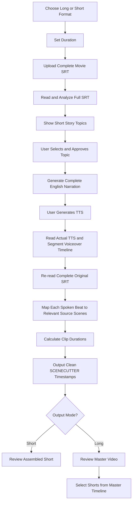

<div align="center">

# Movie Recap Studio

### Open-source Agent Skill + companion SCENECUTTER app releases for movie recap workflows.

[](https://agentskills.io/)
[](https://developers.openai.com/codex/)
[](https://docs.anthropic.com/)
[](LICENSE)

**One movie. One coherent story. A production-ready narration and scene plan.**

[Quick Start](#-quick-start) · [Features](#-what-it-does) · [Workflow](#-how-the-workflow-works) · [Install](#-installation) · [Contributing](CONTRIBUTING.md)

</div>

---

## What is Movie Recap Studio?

Movie Recap Studio is an open-format **Agent Skill** that teaches compatible AI agents to plan and produce original movie explanation videos from a complete subtitle file (SRT) and a final text-to-speech (TTS) recording.

It is designed around a practical editing problem: the written narration is not the final edit reference. The **actual TTS audio** tells the editor what is spoken and when; the **original movie SRT** helps locate the relevant story events and source timecodes.

The skill guides the agent through story analysis, original narration, voiceover timing, a second SRT-reading pass, semantic scene selection, timestamp arithmetic, and optional Shorts planning from the finished master video.

> Movie Recap Studio is a workflow skill, not a video editor, transcription engine, or media-processing application. It uses the host agent's available tools and clearly reports when a capability or source file is unavailable.

## 🎉 First-run experience

After the user **invokes** the installed skill, the agent opens in English:

> Welcome to Movie Recap Studio! Ready to create a movie explanation video?
>
> What would you like to make?  
> **A. Long Video** — Explain the entire movie in one complete video.  
> **B. Short Video** — Create a short recap of the movie.

Then it asks for duration and the complete SRT one question at a time. It presents 3–4 short story-topic options; once one is approved, it immediately writes the complete English narration. The user generates an MP3 with any TTS service and uploads it. The agent analyzes that actual audio, re-reads the SRT, and returns concise source timestamps.

**Important:** installing a skill does not automatically send a message. The welcome starts on the first invocation. The skill uses native selectable question controls when the host supports them (Claude AskUserQuestion or ChatGPT selectable options); concise text choices are the fallback. All user-facing content is English only and deliberately brief.

## 📱 SCENECUTTER companion apps

The GitHub repository holds the **skill source**; GitHub **Releases** will hold desktop and mobile application builds once those builds are ready. This repository package does **not** contain app installers yet.

- **Desktop:** publish actual tested builds for the operating systems you support (for example macOS Apple Silicon).
- **Android:** publish a tested signed APK if your mobile version is native Android.
- **iOS:** requires an appropriate Apple distribution mechanism; a GitHub download alone is not a universal installation route.
- **Integration:** the baseline is copying the skill's clean timestamp block into SCENECUTTER. Automatic app control or API integration is not claimed.

See [Product architecture](docs/PRODUCT-ARCHITECTURE.md), [Release plan](docs/RELEASES.md), and [Onboarding](docs/ONBOARDING.md).

## ✨ What it does

| Capability | What the agent is instructed to do |
|---|---|
| Full-movie explanation | Build one continuous long-form explanation from beginning to ending; default target is around 20 minutes |
| Short movie recap | Create one standalone short-form explanation at a user-selected duration |
| Complete SRT analysis | Read the full subtitle file, validate timecodes, and build a chronological story map |
| Original narration | Write a fresh script with a truthful hook, narrative momentum, re-hooks, and a satisfying resolution |
| TTS-led alignment | Read the final TTS and segment the words actually spoken by audio time |
| Second-pass SRT matching | Re-read the original SRT and map spoken beats to relevant movie events |
| SCENECUTTER output | Produce clean source-movie timestamp ranges in a copy-ready block |
| Shot pacing | Aim for an average shot duration of approximately 4–5 seconds |
| Master-video review | Review an assembled video when media inspection is available |
| Shorts planning | Select standalone segments using the completed master video's timeline |

## 🎬 How the workflow works



### The four timelines are never mixed

| Timeline | Meaning | Used for |
|---|---|---|
| **Source Movie** | Timecode inside the original movie | Extracting original footage |
| **Voiceover** | Timecode inside the final TTS audio | Knowing exactly what is spoken and when |
| **Master Video** | Timecode inside the finished long-form recap | Reviewing the final explanation |
| **Shorts** | Start/end ranges inside the master video | Extracting social clips |

### The defining TTS rule

The user uploads the TTS generated from the narration. The agent reads/transcribes the **actual audio** to understand the words and their timing.

- The TTS is the final spoken source for scene matching.
- The agent does **not** compare it with the earlier draft by default.
- The agent does **not** rewrite, correct, reject, or regenerate the user's TTS.
- The agent then independently re-reads the complete original SRT and maps the spoken beats to relevant movie events.

This avoids wasting time on unnecessary script-difference checks and keeps the scene plan aligned with the narration that will actually be edited.

## SCENECUTTER desktop and mobile app releases

The repository hosts **Movie Recap Studio** as the Agent Skill. The companion **SCENECUTTER** editor can be distributed through GitHub Releases as tested desktop and mobile app binaries become available. **No application binaries are bundled in this source archive.** Check the repository's Releases page after the maintainer publishes actual assets.

Installation is two separate actions: install/invoke the skill in a compatible AI agent, and optionally download/install SCENECUTTER for your operating system. Installing a skill **does not automatically launch a conversation**. Once invoked, it welcomes users in English and asks one setup question at a time.

See [Product Overview](docs/PRODUCT.md), [First-run Onboarding](docs/ONBOARDING.md), and [Release Strategy](docs/RELEASES.md).

## 🚀 Quick Start

### Example request

```text
Use Movie Recap Studio.

I want to create a 20-minute full movie explanation
in English.

Guide me through the workflow one question at a time.
```

For a short recap:

```text
Use Movie Recap Studio.

I want a 90-second movie explanation in English.
Ask me for the required inputs one step at a time.
```

### Expected user journey

1. On the welcome screen, select **Long Video** (one complete explanation of the entire movie) or **Short Video** (one standalone short recap).
2. Choose the target duration.
3. Upload the complete movie SRT.
4. Review a short story summary and choose one topic.
5. Receive the complete English narration in one clean copy-ready block.
6. Generate TTS and upload the final audio.
7. Let the agent read the TTS and map it against the SRT.
8. Receive source-movie timestamp ranges ready for SCENECUTTER.

## 📦 Installation and one-click-style setup

The repository provides native discovery folders for Claude Code, Codex, and Gemini CLI, plus a portable Agent Skills source. ChatGPT uses its supported Skills interface and the standalone ZIP.

> **Repository URL setup:** replace `OWNER/REPOSITORY` below with the actual public GitHub owner and repository name after publishing. These are URL templates until that repository exists.

### Quick install links (copy the URL)

| Platform | Skill directory URL | Install method |
|---|---|---|
| Claude Code | `https://github.com/OWNER/REPOSITORY/tree/main/.claude/skills/movie-recap-studio` | Clone repository, then run `/movie-recap-studio` |
| Codex | `https://github.com/OWNER/REPOSITORY/tree/main/.agents/skills/movie-recap-studio` | Use `$skill-installer` with the directory URL, or open the repository |
| Gemini CLI | `https://github.com/OWNER/REPOSITORY/tree/main/.gemini/skills/movie-recap-studio` | Clone repository; then `/skills list` |
| ChatGPT | `https://github.com/OWNER/REPOSITORY/releases/latest` | Download the standalone skill ZIP and import through Skills where supported |

### Copy-ready install prompts

**Claude Code** — clone/open the repository, then invoke the slash command:

```text
Install Movie Recap Studio from:
https://github.com/OWNER/REPOSITORY

After it is available, invoke /movie-recap-studio.
```

**Codex** — paste the directory URL into the skill installer:

```text
$skill-installer install https://github.com/OWNER/REPOSITORY/tree/main/.agents/skills/movie-recap-studio
```

Then invoke `$movie-recap-studio`.

**Gemini CLI** — clone/open the repository, then check discovery:

```text
/skills list
/skills reload
```

The skill is located at `.gemini/skills/movie-recap-studio/` (Gemini CLI also supports `.agents/skills/`).

**ChatGPT** — download `movie-recap-studio-agent-skill.zip` from Releases and upload it through the Skills interface when available. A standalone skill upload is different from installing a GitHub repository URL.

### Supported folder layout

| Host | Repository path | Notes |
|---|---|---|
| **Claude Code** | `.claude/skills/movie-recap-studio/` | Native project skill discovery; invoke `/movie-recap-studio` |
| **Codex** | `.agents/skills/movie-recap-studio/` | Native repository skill discovery; invoke `$movie-recap-studio` |
| **ChatGPT** | Standalone Agent Skill ZIP | Import through supported Skills interface; product availability varies |
| **Gemini CLI** | `.gemini/skills/movie-recap-studio/` | Native workspace discovery; check with `/skills list` |
| **Other compatible agents** | `skills/movie-recap-studio/` | Portable source; follow each host's own discovery rules |

### Important: choose the correct download

- `movie-recap-studio-github-v2.3.0.zip` — complete source repository for GitHub/repository use. **Do not upload this into a hosted Skill uploader**; it contains nested distributable ZIPs.
- `movie-recap-studio-agent-skill.zip` — standalone skill folder for compatible hosted skill uploaders.
- Host-specific ZIPs — standalone Claude, Codex, or Gemini skill folder packages.

A skill cannot guarantee that every host will auto-activate it immediately after installation. Where required, invoke the documented skill command.

See [the detailed installation guide](docs/INSTALLATION.md).

## First-run greeting

When invoked without an existing setup, the skill immediately asks the user to choose Long Video or Short Video. It then asks for duration and the complete SRT, one concise question at a time. Narration and user-facing communication are English only. This greeting happens on invocation, not automatically on installation.

## 🧱 Repository structure

```text
movie-recap-studio/
├── .agents/
│   └── skills/
│       └── movie-recap-studio/       # Codex + interoperable discovery copy
├── .claude/
│   └── skills/
│       └── movie-recap-studio/       # Claude Code discovery copy
├── .gemini/
│   └── skills/
│       └── movie-recap-studio/       # Gemini CLI discovery copy
├── .github/
│   ├── ISSUE_TEMPLATE/
│   ├── workflows/
│   └── pull_request_template.md
├── docs/
│   ├── ARCHITECTURE.md
│   ├── INSTALLATION.md
│   ├── ONBOARDING.md
│   ├── PRODUCT-ARCHITECTURE.md
│   ├── RELEASES.md
│   └── WORKFLOW.md
├── scripts/
│   ├── build_skill.py
│   └── validate_skill.py
├── skills/
│   └── movie-recap-studio/           # Canonical Agent Skills source
├── .editorconfig
├── .gitignore
├── CHANGELOG.md
├── CODE_OF_CONDUCT.md
├── CONTRIBUTING.md
├── LICENSE
├── README.md
└── SECURITY.md
```

The canonical skill is stored in `skills/movie-recap-studio/`. The Codex, Claude Code, and Gemini CLI copies are mirrored for native discovery. A validation script checks that the copies stay synchronized.

## 🧪 Validation and packaging

Requires Python 3.10+ and uses only the Python standard library.

Validate repository structure and mirrored skill files:

```bash
python scripts/validate_skill.py
```

Build standalone skill archives:

```bash
python scripts/build_skill.py
```

Generated archives are written to `dist/`:
- `movie-recap-studio-agent-skill.zip` — portable Agent Skills bundle
- `movie-recap-studio-codex-skill.zip` — Codex skill folder bundle
- `movie-recap-studio-claude-skill.zip` — Claude-compatible skill folder bundle

## 🧭 Design principles

- **Progressive disclosure:** concise skill metadata; detailed workflow and references load when needed.
- **One question at a time:** interactive setup without overwhelming forms.
- **Original storytelling:** engaging narration without copying long movie dialogue or another creator's script.
- **Evidence-aware analysis:** subtitles are not treated as proof of silent visual action.
- **Audio-led editing:** final TTS, not the draft, defines what is spoken.
- **Semantic scene matching:** understand each spoken beat before selecting a source scene.
- **Timeline integrity:** source, voiceover, master, and Shorts timecodes remain distinct.
- **Honest precision:** calculate durations and disclose uncertainty rather than inventing exactness.

## ⚖️ Copyright and responsible use

The skill creates original commentary and scene-selection plans. It does not grant rights to copyrighted movies, music, or other source material. Users are responsible for obtaining permission or having another valid legal basis for any footage and audio they use. A recap or commentary format is not automatically exempt from copyright claims.

## 🗺️ Roadmap

- [x] Full-movie and short-form modes
- [x] Complete SRT story analysis workflow
- [x] Original narration generation
- [x] TTS-led spoken timeline analysis
- [x] Independent SRT scene-matching pass
- [x] SCENECUTTER timestamp output rules
- [x] Long-form master-to-Shorts workflow
- [x] Codex, Claude Code, and Gemini CLI repository discovery paths
- [x] Skill validation and packaging scripts
- [ ] Community-tested compatibility matrix
- [ ] Optional subtitle parser / timestamp arithmetic helper
- [ ] Optional media-inspection integrations

## 🤝 Contributing

See [CONTRIBUTING.md](CONTRIBUTING.md). Bug reports, workflow improvements, test cases, and host-compatibility notes are welcome.

## License

MIT. See [LICENSE](LICENSE).
