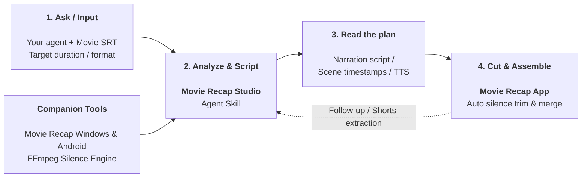

<div align="center">

# Movie Recap Studio

### Open-source Agent Skill + companion editing tools for movie recap workflows.

[](https://github.com/trykamran/movie-recap-studio/releases)
[](https://github.com/trykamran/movie-recap-studio)
[](https://docs.anthropic.com/)
[](LICENSE)

**One movie. One coherent story. A production-ready narration and scene plan.**

[Quick Start](#-quick-start-example) · [Features](#-what-it-does) · [How it works](#how-movie-recap-studio-works) · [Install](#-installation) · [Releases](https://github.com/trykamran/movie-recap-studio/releases)

</div>

---

## What is Movie Recap Studio?

**Movie Recap Studio** is an open-format **Agent Skill** that enables AI models (Claude, ChatGPT, Gemini) to analyze a movie subtitle file (`.srt`), write retention-focused recap narration, and output exact scene timestamps for automated video editing.

---

## 📱 Companion Editing Apps

Movie Recap Studio is accompanied by companion editing applications for **Windows** and **Android** designed to handle video processing seamlessly:

- **Auto Silence Removal:** Automatically cuts dead pauses (>0.3s) for fast-paced, high-retention narration.
- **Audio & Video Sync:** Replaces movie audio with your TTS voiceover while preserving exact cut points.
- **Instant Pasting:** Import timestamps generated by the Agent Skill with one click.

> Precompiled installers and packages (`MovieRecap-Setup.exe` and `MovieRecap.apk`) are available under [**Releases**](https://github.com/trykamran/movie-recap-studio/releases).

---

## ✨ What it does

- **Deep SRT Story Analysis:** Extracts plot beats, chronological scenes, and character arcs from raw subtitles.
- **Viral Recap Narration:** Crafts copyright-safe, engaging narration paced for maximum retention.
- **Automated Scene Alignment:** Generates frame-accurate timestamps mapped to the voiceover.
- **One-Click Video Assembly:** Outputs timestamp lists ready for instant import into the Movie Recap app.

---

## How Movie Recap Studio works

Your agent calls Movie Recap Studio to analyze movie subtitles (SRT), structure chronological storyline beats, and write narration scripts. Movie Recap Studio returns exact scene timestamps and audio sync points. The agent uses them to produce voiceovers and scene timelines, while the companion apps automate silence removal and final video assembly.

### Movie Recap Studio workflow



---

## 📦 Installation

### Claude / Claude Code

Copy and paste this single prompt directly into Claude:

```text
https://github.com/trykamran/movie-recap-studio/tree/main/.claude/skills/movie-recap-studio
Install and load this skill.
```

*(Optional Terminal Install)*:
```bash
git clone https://github.com/trykamran/movie-recap-studio.git ~/.claude/skills/movie-recap-studio
```

---

### ChatGPT / OpenAI

Copy and paste this single prompt directly into ChatGPT:

```text
https://github.com/trykamran/movie-recap-studio/tree/main/.agents/skills/movie-recap-studio
Install and load this skill.
```

*(Custom GPT Builder: Copy instructions from [skills/movie-recap-studio/SKILL.md](skills/movie-recap-studio/SKILL.md))*

---

### Gemini / Antigravity

Copy and paste this prompt:

```text
https://github.com/trykamran/movie-recap-studio/tree/main/.gemini/skills/movie-recap-studio
Install and load this skill.
```

---

## 🚀 Quick Start Example

Paste this into your AI assistant after loading the skill:

```text
Use Movie Recap Studio.

I want to create a movie explanation video.
Here is my movie subtitle file: [paste or attach SRT].
Guide me through the workflow step by step.
```

---

## 📄 License

Distributed under the [MIT License](LICENSE).
