<div align="center">

# Movie Recap Studio

### Open-source Agent Skill + companion editing tools for movie recap workflows.

[](https://github.com/trykamran/movie-recap-studio/releases)
[](https://github.com/trykamran/movie-recap-studio)
[](https://docs.anthropic.com/)
[](LICENSE)

**One movie. One coherent story. A production-ready narration and scene plan.**

[Quick Start](#-quick-start-example) · [Features](#-what-it-does) · [How it works](#how-movie-recap-studio-works) · [Install](#-installation) · [Releases](https://github.com/trykamran/movie-recap-studio/releases)

</div>

---

## What is Movie Recap Studio?

**Movie Recap Studio** is an open-format **Agent Skill** that enables AI models (Claude, ChatGPT, Gemini) to analyze a movie subtitle file (`.srt`), write retention-focused recap narration, and output exact scene timestamps for automated video editing.

---

## 📱 Companion Editing Apps

Movie Recap Studio is accompanied by companion editing applications for **Windows** and **Android** designed to handle video processing seamlessly:

- **Auto Silence Removal:** Automatically cuts dead pauses (>0.3s) for fast-paced, high-retention narration.
- **Audio & Video Sync:** Replaces movie audio with your TTS voiceover while preserving exact cut points.
- **Instant Pasting:** Import timestamps generated by the Agent Skill with one click.

> Precompiled installers and packages (`MovieRecap-Setup.exe` and `MovieRecap.apk`) are available under [**Releases**](https://github.com/trykamran/movie-recap-studio/releases).

---

## ✨ What it does

- **Deep SRT Story Analysis:** Extracts plot beats, chronological scenes, and character arcs from raw subtitles.
- **Viral Recap Narration:** Crafts copyright-safe, engaging narration paced for maximum retention.
- **Automated Scene Alignment:** Generates frame-accurate timestamps mapped to the voiceover.
- **One-Click Video Assembly:** Outputs timestamp lists ready for instant import into the Movie Recap app.

---

## 🎬 How Movie Recap Studio works

Movie Recap Studio connects an **AI Story Agent** with the **Movie Recap Companion App** into a seamless, high-retention video production pipeline:

```mermaid
flowchart LR
    classDef input fill:#1e1e2e,stroke:#6D5DFB,stroke-width:2px,color:#fff;
    classDef ai fill:#2a1b4e,stroke:#a855f7,stroke-width:2px,color:#fff;
    classDef app fill:#0f2b3c,stroke:#06b6d4,stroke-width:2px,color:#fff;
    classDef out fill:#14342b,stroke:#10b981,stroke-width:2px,color:#fff;

    A["📄 <b>1. Input</b><br/>Movie SRT & Settings"]:::input --> B["🧠 <b>2. AI Story Engine</b><br/>Story Map & Viral Hook"]:::ai
    B --> C["🎙️ <b>3. Narration</b><br/>Script & TTS Audio"]:::ai
    C --> D["🎯 <b>4. Scene Matching</b><br/>Precise Timecodes"]:::ai
    D --> E["✂️ <b>5. Movie Recap App</b><br/>Auto Silence Cut & Merge"]:::app
    E --> F["🚀 <b>Final Video</b><br/>YouTube-Ready Export"]:::out
```



### 3-Step Production Pipeline

| Stage | Process | Powered By | Deliverable |
|:---|:---|:---|:---|
| **1. Story & Script** | Analyzes movie SRT, builds chronological story map, and writes a retention-optimized script with the **Viral 3-Sentence Hook**. | **AI Agent** *(Claude / ChatGPT)* | Complete voiceover narration in English or Hindi/Urdu. |
| **2. Audio & Scene Sync** | Takes your generated TTS audio and maps spoken sentences to exact film visual scenes. | **Movie Recap Studio Skill** | Frame-accurate timestamp list ready to copy. |
| **3. One-Click Assembly** | Trims video clips, removes dead pauses (>0.3s) automatically, mutes movie audio, and merges everything with voiceover. | **Movie Recap App** *(Desktop / Android)* | 🎬 Exported master video ready for YouTube & Shorts. |

---

## 📦 Installation (Claude Web & ChatGPT Web)

Most creators use **Claude Web** or **ChatGPT Web** directly in their browser. Here is how to use the skill and save it permanently as the **`/movie-recap-studio`** command:

---

### 🟣 Claude (Web & Desktop)

#### Method 1: Instant Command via Chat (Fastest)
Copy and paste this prompt directly into any Claude chat:

```text
https://raw.githubusercontent.com/trykamran/movie-recap-studio/main/.claude/skills/movie-recap-studio/SKILL.md

Read the skill file above. Install and register this permanently as my `/movie-recap-studio` command. Start the workflow now.
```
> Claude will save the workflow and activate `/movie-recap-studio` immediately.

#### Method 2: Permanent Skill Upload in Claude Customize / Settings
1. Download the ready-to-upload Skill ZIP: [**movie-recap-studio-claude-skill.zip**](https://github.com/trykamran/movie-recap-studio/releases/download/v2.3.0/movie-recap-studio-claude-skill.zip)
2. Open **Claude.ai** → Click your profile icon → **Settings** (or **Customize**) → **Skills**.
3. Click **Upload Skill** and select the downloaded ZIP file.
4. **Done!** `/movie-recap-studio` is now permanently registered and available across all your chats and projects!

---

### 🟢 ChatGPT / OpenAI (Web)

#### Method 1: Instant Prompt in Chat
Copy and paste this prompt directly into ChatGPT:

```text
https://raw.githubusercontent.com/trykamran/movie-recap-studio/main/.agents/skills/movie-recap-studio/SKILL.md

Read the skill file above. Save and register this as my Movie Recap Studio assistant. Start the workflow now.
```

#### Method 2: Create a Custom GPT (Permanent 1-Click Bot)
1. In ChatGPT, open **Explore GPTs** → **Create a GPT**.
2. In **Instructions**, paste the text from [skills/movie-recap-studio/SKILL.md](skills/movie-recap-studio/SKILL.md).
3. Name it **Movie Recap Studio** and save. You now have a permanent dedicated recap generator!

---

### 💻 Developer & CLI Options (Optional)
<details>
<summary>Click to view Claude Code (CLI) and Gemini terminal install</summary>

**Claude Code CLI:**
```bash
git clone https://github.com/trykamran/movie-recap-studio.git ~/.claude/skills/movie-recap-studio
```
*(Windows PowerShell)*:
```powershell
git clone https://github.com/trykamran/movie-recap-studio.git "$env:USERPROFILE\.claude\skills\movie-recap-studio"
```

**Gemini CLI / Antigravity:**
```bash
git clone https://github.com/trykamran/movie-recap-studio.git ~/.gemini/skills/movie-recap-studio
```
</details>

---

## 🚀 Quick Start Example

Paste this into your AI assistant after loading the skill:

```text
Use Movie Recap Studio.

I want to create a movie explanation video.
Here is my movie subtitle file: [paste or attach SRT].
Guide me through the workflow step by step.
```

---

## 📄 License

Distributed under the [MIT License](LICENSE).
