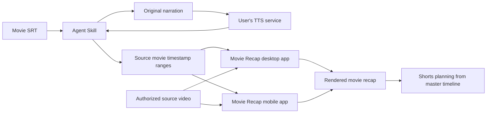

# Product architecture

## Three independently versioned layers

1. **Agent Skill** — prompt-based workflow: story analysis, narration, audio-led timing, SRT re-read, Movie Recap timestamp list. Works without installing Movie Recap, provided the host can access required files and media tools.
2. **Desktop application** — distributed as a signed or verified release artifact for each supported OS and CPU architecture. Imports or pastes source time ranges and cuts authorized source media locally.
3. **Mobile application** — distributed as an Android APK or other platform-specific package only when actually built and tested. An iOS application requires an appropriate Apple distribution route; do not promise direct iOS installation from GitHub Releases.

## Boundary diagram

## Release separation

- Skill version is tracked in `SKILL.md` and `CHANGELOG.md`.
- App versions are separate. Never imply that a skill version number guarantees app compatibility.
- Publish an explicit compatibility matrix after testing. Until then, mark integrations as unverified.
- Avoid distributing copyrighted movie footage or users' TTS recordings in the repository.

## Future integrations (not implemented)

Optional structured timeline JSON, native timestamp file import, and direct app communication should be designed and documented only after the application supports them. Plain text ranges are the stable baseline.
